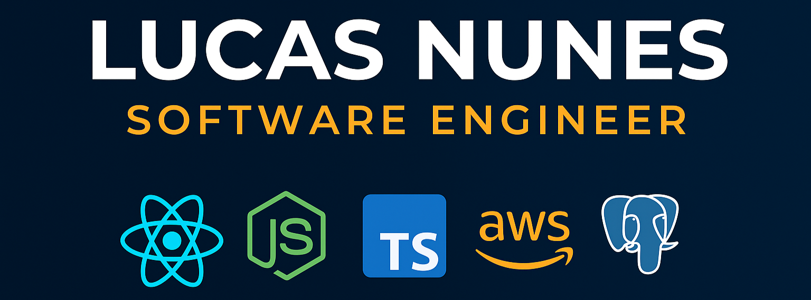

# Hey, I’m Lucas

**Senior Full-Stack Engineer · Founder of Avionyx**

I build web applications, API integrations, and data pipelines. I’ve spent 7+ years shipping production software in healthcare and financial services, from working through requirements with clients to debugging issues after release.

## What I’m building

I started [Avionyx](https://avionyx.io/) to help contractors find public construction bids in one place. It pulls opportunities from federal, state, and local procurement portals into a searchable feed with email digests and CSV exports.

- **Data ingestion.** I built connectors for SAM.gov, PA eMarketplace, SEPTA, and other procurement portals. The pipeline normalizes records, catches duplicates, handles retries and rate limits, and protects existing records from bad updates.
- **Product and integrations.** I implemented authentication, workspace permissions, Stripe Checkout and billing webhooks, and alerts for failed ingestion jobs.
- **AI-assisted development.** I set up a workflow where coding agents work from Linear tickets with acceptance criteria and open pull requests for review. It uses AI-assisted code review, GitHub Actions checks, and human approval before merge. Avionyx has a suite of 2,100+ automated tests.

## Enterprise engineering

- **ICF (formerly SemanticBits).** I build React and TypeScript features, Node.js and GraphQL APIs, and SQL-backed workflows for a regulated healthcare platform serving CMS. I lead sprint demos and trace production issues across the browser, APIs, AWS logs, and database.
- **UI architecture.** I redesigned shared navigation used across multiple enterprise applications, built a reusable framework for create and edit flows with shared validation, and reduced render blocking in data-heavy dashboards.
- **EY.** I delivered tax and financial-services applications, worked directly with clients to clarify requirements and explain implementation tradeoffs, and led three developers through estimates, code reviews, and releases.

**Tools I use** · TypeScript, React, Node.js, REST, GraphQL, PostgreSQL, Prisma, AWS, Docker, Playwright, Vitest, GitHub Actions

[Avionyx](https://avionyx.io/) · [LinkedIn](https://www.linkedin.com/in/nunesmlucas/) · [Email](mailto:nunesmlucasg@gmail.com)
